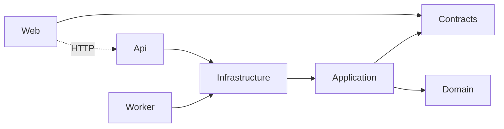

# Ninth Parallel Coffee Roasters — Product and Copilot Demonstration Plan

**Status:** Baseline coffee catalog implemented; commerce and advanced operations form the demo
backlog.
**Product:** Ninth Parallel Coffee Roasters
**Stack:** .NET 10, Aspire, Blazor, ASP.NET Core, PostgreSQL, Redis/HybridCache, OpenTelemetry
**Purpose:** Demonstrate GitHub Copilot evolving a real application through GitHub Projects,
specialized agents, skills, MCP, independent review, deterministic gates, and a human merge boundary.

---

## 1. Product Boundary

Ninth Parallel is a specialty-coffee commerce application. It understands coffee and commerce; it
does not understand GitHub, Copilot, pull requests, gates, or agent evidence.

The engineering harness lives outside the product:

```text
Product                           Delivery harness
-------------------------------   ---------------------------------
Coffee catalog and producers      GitHub Project roadmap
Sensory and traceability data      Copilot agents and skills
Bag/grind variants and stock       Microsoft Learn MCP
Brew recipes and ratio tools       Review and threat-model agents
Cart, checkout, and orders         Deterministic quality gate
Operations and fulfillment        Hooks, workflows, evidence, ledger
```

That separation lets the demonstration show Copilot working on the same kind of application an
engineering team would actually own.

## 2. Audience

- **Curious drinker:** recognizes flavor and brew method but wants origin/process explained.
- **Coffee enthusiast:** expects elevation, variety, fermentation, harvest, cup score, and lot data.
- **Gift buyer:** needs accessible guidance without learning the entire taxonomy.
- **Roaster/operator:** needs publication, stock, freshness, and fulfillment controls.

## 3. Baseline Journeys

1. Land on an image-led current-release page.
2. Filter coffee by origin, process, roast, tasting note, score, or price.
3. Open a coffee and understand producer, elevation, varieties, process, roast, sensory profile,
   traceability, variant availability, and recipes without leaving the page.
4. Follow a producer link to their story and current lots.
5. Scale a V60 recipe in the Brew Lab.
6. Select bag/grind and add a coffee to a cart.
7. Observe API, Worker, Postgres, Redis, logs, traces, and health in Aspire.

## 4. Baseline Data Model

### Coffee aggregate

- Identity: stable ID, slug, name, status, short description, story
- Origin: country, region, subregion, farm, elevation range
- Agronomy: ordered varieties
- Processing: method, fermentation hours, drying method, harvest label
- Roast: level, intent, date, rest window, derived freshness
- Sensory: ordered tasting notes, cup score, acidity/body/sweetness, acidity type
- Traceability: lot code, import partner, available FOB price, certifications
- Variants: SKU, bag size, grind, USD price, stock, active state
- Images: URL, alt text, hero designation, order
- Recipes: method, dose, yield, ratio, temperature, time, grind, instructions

### Producer aggregate

- Stable ID and slug
- Farm, cooperative, washing-station, or estate kind
- Country, region, elevation, farm size, relationship start year
- Story and image metadata

## 5. Invariants

- Cup score is between 60.0 and 100.0.
- Minimum elevation cannot exceed maximum elevation.
- Tasting notes are ordered, unique, and limited to five primary notes.
- A coffee cannot publish without a hero image and active variant.
- Fermented processes require a positive fermentation duration.
- Bag sizes are 250 g, 500 g, or 1 kg.
- Price is positive and stock never becomes negative.
- Reserving the final unit deactivates the variant.
- Brew dose/yield/temperature/time must be physically plausible.
- Freshness is derived from roast date and rest window, not persisted as stale state.

## 6. Architecture

Dependencies continue to point inward:



- Web reaches product data through HTTP only.
- Application owns ports and use cases, never EF, Redis, or `HttpClient`.
- Infrastructure owns EF mappings, repositories, deterministic seed, and cache adapter.
- PostgreSQL is authoritative for product, price, and stock.
- Redis accelerates catalog reads but never authorizes checkout stock.
- Product code never reaches GitHub.

## 7. Implemented Baseline

- [x] Coffee, producer, descriptor, variant, image, and recipe domain model
- [x] Publish, score, tasting-note, stock, ratio, and freshness invariants
- [x] EF Core mappings and additive migration
- [x] Deterministic 12-coffee, 10-country, 10-producer seed
- [x] Catalog repository with search, filters, sorting, paging, and facets
- [x] Versioned HybridCache-backed list/detail/producer reads
- [x] Catalog, coffee-detail, and producer HTTP endpoints
- [x] Image-led home, shop, coffee, producer, brew, transparency, and cart pages
- [x] Desktop and mobile responsive layouts without horizontal overflow
- [x] Store-focused Worker catalog warming
- [x] Domain tests and Docker-backed catalog integration tests
- [x] Aspire topology with persistent Postgres, Redis, migrations, API, Worker, and Web

## 8. Deliberate Copilot Demo Backlog

These are intentionally not prebuilt. Each is sized to reveal a different capability.

| ID | Issue | Engineering capability demonstrated |
|---|---|---|
| NP-101 | Persist carts across refresh and circuits | Cross-layer state, Redis, privacy |
| NP-102 | Add idempotent guest checkout | Domain workflow, transactions, payment port |
| NP-103 | Prevent overselling under concurrent checkout | EF concurrency, Testcontainers |
| NP-104 | Add promotion codes and coffee bundles | Business invariants, property tests |
| NP-105 | Add wishlists | Vertical feature, Blazor interactivity |
| NP-106 | Add coffee subscriptions | Recurrence, Worker scheduling, idempotency |
| NP-107 | Add product reviews and moderation | Validation, threat model, UGC security |
| NP-108 | Add live low-stock updates | Redis pub/sub, SignalR, cache invalidation |
| NP-109 | Add customer accounts and order history | Authentication, authorization, privacy |
| NP-110 | Add taste-preference quiz | UX flow, recommendation rules |
| NP-111 | Add full-text catalog search | PostgreSQL search, ranking, performance |
| NP-112 | Add image upload to object storage | External adapter, security, asset handling |
| NP-113 | Accessibility audit and repair | Playwright, axe, code review |
| NP-114 | Optimize catalog cache under load | Learn MCP, benchmarks, resilience |
| NP-115 | Diagnose a flaky checkout test | Repair orchestrator, two-attempt rule |
| NP-116 | Add an AI coffee guide | Foundry integration, evaluation, safety |

## 9. GitHub Project Design

Fields:

- Status: Backlog, Ready, In progress, Review, Gate failed, Awaiting human, Done
- Priority: P0–P3
- Workstream: Catalog, Commerce, Inventory, Experience, Platform, Harness
- Risk: Low, Medium, High, Critical
- Agent Stage: Planning, Implementing, Reviewing, Verifying, Needs human
- Gate: Not run, Pass, Fail, Inconclusive
- Evidence: canonical report/check URL
- Target Date

Views:

- Product Backlog
- Agentic Flow
- PR Readiness
- Gate Risk
- Demo Run

## 10. Demonstration Flow

For one Project issue:

1. Run the GitHub delivery preflight and declare local or connected mode.
2. Scope the issue into numbered requirements and explicit non-goals.
3. Research any uncertain .NET API through Microsoft Learn MCP.
4. Ask an architecture reviewer and Rubber Duck to challenge non-trivial plans.
5. Delegate implementation to the narrowest non-overlapping specialists.
6. Run test and threat reviews in parallel, maximum three workers.
7. Normalize structured evidence locally; publish only when a connected sink passed preflight.
8. Run the deterministic gate at the strongest available profile.
9. Demonstrate proposer/verifier ledger invariants. Append durably only when a trusted sink exists.
10. In connected mode, update the PR and Project idempotently and stop for human authorization. In
    local mode, emit dry-run deltas and the missing capabilities. No agent merges.

## 11. Remaining Harness Work

- [ ] Create the private GitHub repository and configure `origin`
- [ ] Configure and verify least-privilege GitHub issue, Project, pull-request, and evidence tools
- [ ] Provision the GitHub Project, fields, views, labels, issue form, and PR template
- [ ] Deny agent edits to `eng/agent-hooks/**` and `eng/tests/**` mechanically
- [ ] Deny delivery-time self-edits to customization/`AGENTS.md` paths and shell writes by
    read-only roles
- [ ] Add explicit CODEOWNERS entries for every customization contract, not only the catch-all
- [ ] Harden hook path canonicalization and fail closed when `jq` or policy loading is unavailable
- [ ] Make the protected-path workflow fail, rather than warn, on human-owned path changes
- [ ] Pin GitHub Actions to immutable SHAs and add Dependabot
- [ ] Add trusted quality-report ingestion, evidence validation/publication, and an append-only
    ledger publisher with read-back verification
- [ ] Add bUnit and Playwright projects, accessibility scan, and responsive screenshots to CI
- [ ] Add plugin, canvas, and three agentic-workflow demonstrations
- [ ] Record the end-to-end acceptance run and capability-matrix evidence

## 12. Verification

The baseline is acceptable only when:

- locked restore, formatter, full build, unit, architecture, gate, and integration tests pass;
- two gate runs for one commit produce the same canonical hash;
- AppHost reports API, Worker, and Web healthy and migrations finished;
- catalog API returns exactly 12 seeded coffees with stable slugs;
- coffee detail includes sensory, processing, traceability, variants, and three recipes;
- desktop and 390 px mobile views have no horizontal overflow or clipped controls;
- Project/PR writes remain unavailable until connected preflight passes, and checkout remains
    absent until its bounded issue is implemented;
- the product contains no GitHub or Copilot delivery concepts in customer-facing screens.

## 13. Non-Goals for This Baseline

- Real payment processing or stored card data
- Customer identity or saved PII
- Real tax calculation or international shipping
- Reviews, promotions, subscriptions, or email sending
- Product image upload pipeline
- AI-generated tasting notes or unsupported traceability claims
- Agent-controlled merge or branch protection

Those are future issues, not hidden partial implementations.